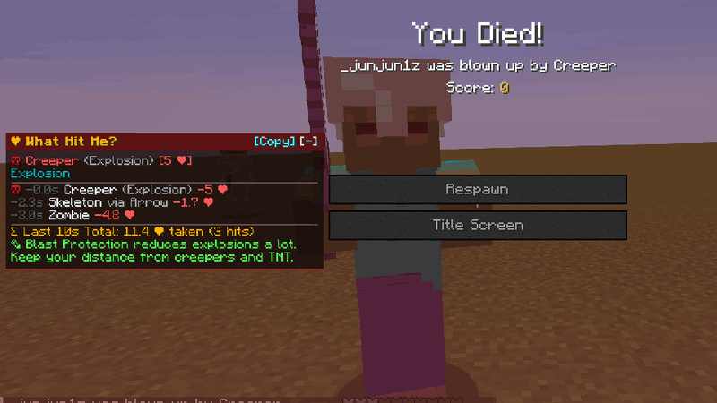
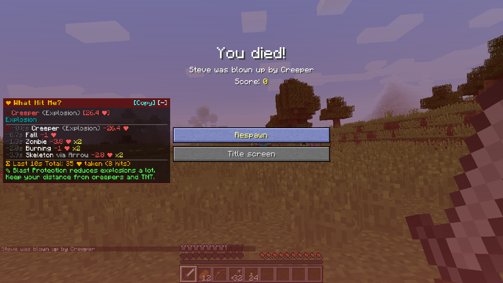

# What Hit Me?

「何にやられたのか」をはっきり見せる Minecraft 1.7.10〜26.3 の Forge・Fabric・NeoForge 用の Mod です。**どんな Mod パックでも、どんな Mod の組み合わせでも動きます。必須の前提 Mod はありません。**



[English README](README.md)



- Minecraft 1.7.10〜26.3：Forge、Fabric（Fabric API が必要、Mod Menu は任意）、NeoForge の 63 ビルド。対応表は [docs/description.md](docs/description.md#supported-versions) にあります。
- Mod ID は `whathitme`
- クライアントだけ、サーバーだけ、両方、どの入れ方でも動作。ブロックやアイテムの追加はなし。Forge / NeoForge は標準イベントのみ（Mixin・コアMod なし）。Fabric は Fabric API のイベントと、イベントが無い所だけ小さな Mixin を使います
- ライセンス: MIT

## 設計

- 記録するのはプレイヤーだけです。ダメージ・死亡の処理は、それ以外のエンティティなら最初の1行で終わります。偽プレイヤーは無視します。
- サーバーの tick ハンドラーはありません。時間の判定、連続ダメージのまとめ、反射ダメージ、クールダウンはすべて時刻の差で計算します。被弾の処理が終わってから確認が必要なものだけ、サーバーのタスクキューに1回だけ登録します。
- 通信は死亡時、トーテム・大ダメージ時、コマンド実行時だけです。被弾ごとには送りません。
- Mod 一覧のキャッシュ: ダメージの種類・モブ・効果は一度だけ調べ、`modid:バージョン` の一覧（ソート済み）の SHA-256 と一緒に保存します。次回の起動で Mod 構成が同じならキャッシュから読み込み、変わっていたとき（または `/whm reload`）だけ調べ直します。
- イベント処理、パケット処理、スキャン、画面の描画は、それぞれ自分でエラーと null を受け止めて「不明」として扱います。他の Mod の壊れたダメージ源・エンティティ・アイテム・テキストがクラッシュとして広がらないようにしています。
- 履歴はプレイヤーごとの固定長リングバッファで、エンティティへの参照を持たない不変レコード（数値と文字列だけ）です。ログアウト時に破棄します。

## 機能

- **死亡画面のパネル**: 致命傷、死亡メッセージ、ダメージの属性、直前30秒のすべての被弾、「直前10秒の合計」、ヒントを表示。行にマウスを乗せると詳細。ヘッダーをドラッグで移動、`[-]` で最小化、ホイールでスクロール、`[コピー]` で内容をコピー。
- **リスポーン時のチャット通知**（自分のチャット欄だけ）: 致命傷、属性、直前10秒の合計、ヒント、詳細へのリンク。`/whm togglechat` で消せます。
- **被ダメージ履歴**（`/whm`）: 生きている間も含めた最近の被弾。同じ発生源からの3秒以内の連続ダメージは1行にまとめてヒット数を表示（`x12回`）。
- **マウスオーバーの詳細**: 防具による軽減前後のダメージ、軽減率、衝撃吸収の消費量、被弾後の体力、攻撃者の武器とエンチャント、距離、`[透明]` の攻撃者、タレット・ペット・矢の所有者、追加した Mod、内部ダメージID。`[IDをコピー]` `[非表示]` ボタン付き。
- **最大体力に対する割合**: `(最大HPの30%)` のように、被弾した時点の最大体力に対する割合を表示します。
- **周囲の状況**: 攻撃者のいないダメージ（炎、溶岩、サボテン、Mod の酸や感電ブロックなど）では、足元と体の位置にあるブロック・液体と、両手に持っているアイテムを、それぞれの Mod 名つきで表示します。連続ダメージでワールドを調べるのは最初の1回だけです。
- **反射ダメージ**: 棘の鎧のダメージや、直前（50ミリ秒以内）に自分が殴った相手からのダメージに `[⚡ 反射 / 棘の鎧]` を付け、専用のヒントを出します。
- **防具の破損**: 防具が壊れると、その時点のタイムラインに `[⚠ 破損: <防具名>]` を表示します。
- **トーテム・蘇生のスナップショット**: 不死のトーテムが発動したとき、他の Mod が死亡を取り消したり死亡後に体力を戻したりしたとき、1撃で最大体力の80%以上を失ったときに、その瞬間を保存して `[詳細]` リンク付きでチャットに通知（`/whm snapshot`）。
- **体力系 Mod への対応**: 合計体力が残ったまま死亡した場合（First Aid のような部位ダメージ）は `[部位 / 急所ダメージ (合計HPがX.X残った状態で死亡)]` と表示します。ダメージイベントなしに死亡した場合（`setHealth(0)` など）も、死亡イベントから致命傷を作るので詳細が空になりません。
- **`[詳細をコピー]`**: Markdown 形式でコピー。ディメンション、座標（任意）、最大体力、防具4部位のエンチャントと破損状態、効果も含めます。
- **統計**（`/whm stats`）: 死亡回数の合計、受けたダメージの合計、死因の上位5件。
- **効果一覧**（`/whm effects`）: 現在の効果、追加した Mod、レベル、残り時間、牛乳で消せるか（`[牛乳 ✔]` / `[牛乳 ✖]`）。
- **検索**（`/whm search`）: ダメージの種類・モブ・効果を `#bypasses_armor`、`#absolute`、`#magic`、`#fire`、`#explosion`、`#projectile`、`#damage`、`#scanned`、`#mob`、`#effect`、`#debuff`、`@modid`、または文字列で検索。組み合わせも可（`@minecraft zombie`）。
- **ダメージIDのスキャン**: Mod のダメージIDを、誰かがそのダメージを受ける前から一覧に載せます（下記参照）。
- **設定画面**: `/whm config` でどのバージョン・ローダーでも開けます。Forge / NeoForge では Mod 一覧から、Fabric では Mod Menu を入れていればそこからも開けます。パックでロックされた項目は操作できない状態で表示されます。
- **自動ヒント**: ダメージの種類と属性に応じた対策を表示。ダメージIDごとに差し替え可能。
- 10言語対応。

古い Minecraft のフォントは絵文字を表示できないため、ゲームのフォントにある記号（☠ ⚠ ❤ ⚡ Σ）と文字のラベルを使っています。

## 導入パターン

| 入れる場所 | プレイヤーに見えるもの |
|---|---|
| クライアントとサーバー | サーバーからの正確なデータ（軽減前ダメージ、軽減率、衝撃吸収、武器、所有者、盾・無敵時間のフラグ、防具、周囲の状況）。各自の言語で表示。クリップボードへのコピーボタン。サーバーの `whathitme-common.cfg` と pack フォルダが全員に適用されます。 |
| クライアントだけ | クライアント側の推定モード。自分の体力を比べ、減ったときだけ原因を推測します（落下、溶岩、炎、溺れ、窒息、奈落、近くのモブ、飛び道具、爆発、毒、ウィザー、空腹）。記録には `[クライアント推定]` が付きます。`/whm inspect` は使えません。 |
| サーバーだけ | Mod を入れていないプレイヤー（素の Forge クライアントでも）に英語のチャットを送ります。リスポーン時の通知、トーテム・大ダメージの通知、すべての `/whm` コマンド。`[Copy ID]` は ID をチャット欄に入力します。`togglechat` と `ignore` はプレイヤーごとに保存されます。 |

シングルプレイは「クライアントとサーバー」の扱いです。入れている人と入れていない人が混在するサーバーでは、各プレイヤーにそのクライアントで使える最良のモードが選ばれます。サーバー側で OFF にした機能（common 設定や `lockedFeatures`）は、サーバーがパケットを作る段階で取り除かれます。1.0 / 1.1 のクライアントと 1.2 のサーバーの組み合わせ（その逆も）でも動作します。

## Mod パック製作者の方へ

### 入れる理由

- 「何で死んだの？」という質問が減ります。攻撃者、その Mod、ダメージの種類をプレイヤーが自分で確認できます。
- ダメージの種類・攻撃者・武器・ディメンションの組み合わせで、パック独自のヒントや表示名を出せます。不要な表示は隠せます。
- 前提 Mod なし、ワールドデータなし、ログイン時のチャット表示なし。いつ追加・削除しても安全です。

### ファイル

```
config/whathitme/
  whathitme-common.cfg    パック・サーバーの設定
  whathitme-client.cfg    個人の設定とパネルの配置
  hint_template.cfg       /whm dump が書き出すテンプレート
  pack/                   パック定義: hints/ renames/ ignored/ triggers/ custom/（どのサブフォルダの *.json でも可）
  .cache/                 catalog_cache.json、stats_<uuid>.json、whathitme_dump.csv
```

| ファイル | 対象 | 内容 |
|---|---|---|
| `whathitme-common.cfg` | パック製作者・サーバー管理者 | 表示の ON/OFF、ヒントの ON/OFF、フィルター（`ignoredDamageIds`、`renameMap`、`hintMap`、`minDamageThreshold`、`heavyHitThreshold`）、記録の設定（`historySize`、`mergeWindowSeconds`、`summarySeconds`、`recapSeconds`、`maxSnapshots`）。Mod 入りのサーバーは、ログイン時と再読み込み・設定変更時にこのファイルを Mod 入りクライアントへ送り、クライアント側の common ファイルの代わりに使わせます。 |
| `whathitme-client.cfg` | 各プレイヤー | 個人用の表示 ON/OFF とフィルター、`showHints`、死亡画面パネルの配置（`anchorPoint`、`offsetX`、`offsetY`、`scale`、`backgroundOpacity`、`maxVisibleLines`、`minimized`、`chatHistoryLines`）。 |

2つの `.cfg` はどのローダーでも Forge の設定形式で、`/whm reload` で再起動なしに再読み込みできます。表示は **両方のファイルで** `true` の項目だけです。個人の `renameMap` / `hintMap` はパックの設定の上に適用されます。優先順位は `.cfg` の設定 > pack の JSON > 内蔵の自動ヒント です。

<details>
<summary>全設定項目</summary>

**表示の ON/OFF**（両方のファイル、カテゴリ `display`、初期値はすべて `true`）:
`enableDeathScreenPanel`、`enableRespawnChatSummary`、`enableTotemChatAlert`、`enableHeavyHitSnapshot`、`showTimestamp`、`showDamageAmount`、`showMitigationDetails`、`showSmartMergeHitCount`、`showSourceModName`、`showDamageProperties`、`showInternalDamageId`、`showAttackerName`、`showAttackerWeapon`、`showAttackerDistance`、`showAttackerInvisibility`、`showEntityOwner`、`showActionButtons`、`showToggleChatNotice`、`showMaxHpPercentage`、`showEnvironmentContext`、`showReflectedBadge`、`showArmorBreakEvents`、`includeEquipmentInCopy`、`includeCoordsInCopy`（`includeEquipmentInCopy` が必要）

**ヒント**（カテゴリ `display`、初期値 `true`）: `enableAutoHints` と `enableCustomHints`（common ファイルのみ）、`showHints`（client ファイルのみ）。1.0 / 1.1 の `showHintsAndTips` の代わりです。古い `showHintsAndTips=false` が残っていると3つとも OFF にしたうえで、古いキーを削除します。

**フィルター**（両方のファイル、カテゴリ `filters`）:

| キー | 初期値 | 意味 |
|---|---|---|
| `minDamageThreshold` | 0.05 | これ未満のダメージは記録しない |
| `heavyHitThreshold` | 0.8 | 最大体力のこの割合以上を1撃で失うと大ダメージ扱い |
| `ignoredDamageIds` | 空 | 非表示にするキー（複合キー、`*` ワイルドカード可） |
| `renameMap` | 空 | `キー = 名前` または `キー = lang:翻訳キー` |
| `hintMap` | 空 | `キー = ヒント` または `キー = lang:翻訳キー` |

`whathitme-client.cfg` 側のしきい値はクライアントだけの推定モードでのみ使われます。それ以外はサーバーが記録します。

**記録**（common ファイルのみ、カテゴリ `tracking`）:

| キー | 初期値 | 意味 |
|---|---|---|
| `historySize` | 50 | プレイヤーごとに保持する記録数（5〜500） |
| `mergeWindowSeconds` | 3.0 | 連続ダメージをまとめる秒数（0 で無効） |
| `summarySeconds` | 10 | 「直前X秒の合計」の秒数 |
| `recapSeconds` | 30 | 死亡の詳細にさかのぼって含める秒数 |
| `maxSnapshots` | 5 | プレイヤーごとのトーテム・大ダメージのスナップショット数 |

**配置**（client ファイルのみ、カテゴリ `layout`）:

| キー | 初期値 | 意味 |
|---|---|---|
| `anchorPoint` | `CENTER_LEFT` | `TOP_LEFT`、`TOP_RIGHT`、`BOTTOM_LEFT`、`BOTTOM_RIGHT`、`CENTER_LEFT`、`CENTER_RIGHT` |
| `offsetX` / `offsetY` | 4 / 0 | 基準位置からのずれ。パネルをドラッグすると保存 |
| `scale` | 0.85 | パネルの大きさ |
| `backgroundOpacity` | 0.75 | 背景の不透明度（0.0〜1.0） |
| `maxVisibleLines` | 8 | スクロールせずに見える行数 |
| `minimized` | false | `[-]` ボタンで保存 |
| `chatHistoryLines` | 15 | `/whm history` で表示する行数 |

</details>

### pack フォルダ

`config/whathitme/pack/` が無ければ、`hints/`、`renames/`、`ignored/`、`triggers/`、`custom/` を作り、それぞれに `_example.json` を置きます。例の中身はコメントアウトされているので、編集するまで何も起きません。`pack/` 以下の `.json` はすべて、パスのアルファベット順に読み込んでまとめます。後のファイルが前のファイルの同じキーを上書きします。コメント（`//`、`/* */`）と末尾のカンマも使えます。どのファイルにどのキーを書いても構いません。

```json
{
  "renameMap": {
    "minecraft:outOfWorld": "&5The Abyss",
    "mob:minecraft:zombie @item:minecraft:iron_sword": "Armed Zombie"
  },
  "hintMap": {
    "minecraft:lava @dim:minecraft:the_nether": "Carry Fire Resistance potions in the Nether.",
    "mob:lycanitesmobs:*": "lang:mypack.hint.lycanites"
  },
  "defaultIgnoredDamageIds": ["minecraft:cactus"],
  "lockedFeatures": ["showInternalDamageId"],
  "deathTriggers": [
    { "match": "minecraft:lava", "command": "say {player} fell into lava at {x} {y} {z}", "cooldownSeconds": 60 },
    { "match": "mob:minecraft:creeper", "command": "give {player} minecraft:bread 4", "oncePerPlayer": true }
  ]
}
```

- `renameMap`、`hintMap`: オブジェクト（`"キー": "値"`）または `"キー = 値"` の文字列のリスト。値を空にすると、前のファイルの同じキーを取り消します。`&` のカラーコードが使えます。`lang:<翻訳キー>`、または翻訳キーそのものを値にすると、各プレイヤーのクライアントで翻訳されます。リソースパックで各言語の文を用意できます。
- `defaultIgnoredDamageIds`: 全員に対して最初から非表示にするキー。
- `lockedFeatures`: 設定画面からも `/whm config` からも変更できなくする設定キー。シングルプレイでも変更できません。
- `deathTriggers`: 下記参照。
- `/whm reload` でフォルダを読み直し、読み込んだファイル数と、読めなかったファイル（そのファイルは飛ばします）を表示します。

### 複合キー

`renameMap`、`hintMap`、`ignoredDamageIds`、`defaultIgnoredDamageIds`、`deathTriggers` で使えます。条件は順不同で、スペース（または `&`）で区切ります。

| 条件 | 一致するもの |
|---|---|
| `minecraft:lava`、`mob:minecraft:zombie` | ダメージID。エンティティからの攻撃は `mob:<エンティティID>`、それ以外は `<modid>:<ダメージの種類>`（`minecraft:fall`、`minecraft:outOfWorld`、`minecraft:explosion.player` など） |
| `@minecraft:zombie`、`@mob:minecraft:zombie` | 攻撃者のエンティティID |
| `@item:minecraft:iron_sword` | 攻撃者がメインハンドに持っているアイテム |
| `@dim:minecraft:the_nether` | ディメンション（名前空間なしの `the_nether` でも一致） |

どの条件にも `*` ワイルドカードが使えます。キーの条件はすべて一致する必要があり、複数のキーが一致したときは条件の数が多いものが優先されます。

### 死亡トリガー（deathTriggers）

各項目は `match`（複合キー）と `command`、任意で `oncePerPlayer`（初期値 `false`。プレイヤーの統計ファイルに記録されるので再起動後も有効）と `cooldownSeconds`（プレイヤーごと、初期値 `0`）を持ちます。置き換え文字: `{player}`、`{x}`、`{y}`、`{z}`（死亡したブロック座標）、`{damage}`（致命傷の体力ポイント、小数1桁）。コマンドはサーバー側だけで、コンソールの権限で実行されます。一致したトリガーはすべて、ファイルの順に実行されます。先頭の `/` はあってもなくても構いません。

### `/whm test`

`/whm test <ダメージID> [エンティティID] [アイテムID] [ディメンションID]`（OP）は、仮の致命傷を作り、表示名、ヒント、実行されるはずの死亡トリガー（置き換え文字を埋めた形で表示するだけで、実行はしません）、チャットのプレビューを表示します。`-` で引数を飛ばせます。ディメンションを省くと実行した人のディメンションになります。

### ダメージIDのスキャンと `/whm dump`

Mod のダメージIDは、誰かがそのダメージを受ける前から一覧に載ります。

- 1.7.10〜1.19.3: キャッシュが使えないとき（初回起動、Mod 構成の変更、`/whm reload`）に、バックグラウンドのスレッドが Mod の jar のクラスファイルを読み（クラスは読み込みません）、ダメージ源のコンストラクタに渡される文字列のIDを集めます。サブクラスや、コンストラクタ直後のセッター呼び出しも対象です。jar の中の jar は1階層まで読みます。結果は `catalog_cache.json` の `scan` に保存します。
- 1.19.4 以降: ゲームのダメージタイプのレジストリにすべてのキーがあるので、それを直接読みます（属性はタグから取得）。スキャンは不要です。

見つかったIDは `/whm search`（`#scanned`）、`/whm test` の補完、`/whm dump` に出ます。`/whm dump`（OP）は次のファイルを書き出します。

1. `config/whathitme/.cache/whathitme_dump.csv`: すべてのダメージの種類・モブ・効果と、その Mod、属性、発生回数、設定済みの表示名・ヒント・非表示、`source`（`seen`、`scanned`、`registry`）。
2. `config/whathitme/hint_template.cfg`: 分かっているすべてのダメージIDと、登録されている全モブの `mob:<ID>` を値なしで並べた `S:hintMap <...>` と `S:renameMap <...>` のブロック。`whathitme-common.cfg` に貼り付けて、必要な行だけ値を書きます。値が空の行は無視されます。

### 統計

`/whm stats` は死因ごとの死亡回数と、実際に減った体力を数えます。メモリに置くのはプレイヤーごとに最大100件の死因で、`.cache/stats_<uuid>.json` に書き込むのは死亡時、ログアウト時、ワールド保存時だけです。

### Mod パックに入れてもいいですか？

はい。MIT ライセンスです。連絡も不要です。

## コマンド

`/whm`（別名 `/whathitme`）。すべて Tab キーで補完できます。「OP」は権限レベル2、またはチートを有効にしたシングルプレイのことです。

| コマンド | 内容 | 使える人 |
|---|---|---|
| `/whm` または `/whm history` | 最近の被ダメージ | 全員 |
| `/whm last` | 直前の死亡の詳細 | 全員 |
| `/whm snapshot [番号]` | 保存されたトーテム・大ダメージのスナップショット（1 が最新） | 全員 |
| `/whm effects` | 現在の効果、Mod、牛乳で消せるか | 全員 |
| `/whm stats` | 死因ごとの死亡回数、死亡回数の合計、受けたダメージ | 全員 |
| `/whm search <文字列\|#タグ\|@modid>` | ダメージの種類・モブ・効果を検索 | 全員 |
| `/whm togglechat` | リスポーン時のチャット通知の ON/OFF | 全員 |
| `/whm ignore <ID>` | ダメージIDの非表示・再表示 | 全員（個人）、サーバーのリストは OP |
| `/whm config` | 設定画面を開く（Mod を入れていないプレイヤーには設定の一覧を表示） | 全員 |
| `/whm config <キー> [値]` | 設定の表示・変更（`true`/`false`/`on`/`off`/`toggle`） | 個人の設定: 全員、common の設定: OP |
| `/whm rename <ID> <名前...>` | 表示名の変更（空で削除） | OP |
| `/whm sethint <ID> <ヒント...>` | ヒントの設定（空で削除） | OP |
| `/whm inspect <プレイヤー>` | オンラインのプレイヤーの直前の死亡と履歴 | OP |
| `/whm test <ダメージID> [エンティティ] [アイテム] [ディメンション]` | 表示名・ヒント・死亡トリガー・チャットのプレビュー | OP |
| `/whm dump` | `whathitme_dump.csv` と `hint_template.cfg` を書き出す | OP |
| `/whm reload` | 設定ファイルと pack フォルダの再読み込み、カタログの再スキャン | OP |
| `/whm server <サブコマンド>` | Mod 入りクライアントからサーバー側で実行 | サーバーに Mod が必要 |
| `/whm help` | コマンド一覧 | 全員 |

`lockedFeatures` に書かれたキーは誰も変更できません。Mod 入りクライアントからの `rename` / `sethint` は自分の個人ファイルを変更します。サーバーの common ファイルを変えるには `/whm server rename ...` を使います。`/whm copy` と `/whm copyrecap` は `[IDをコピー]` `[詳細をコピー]` ボタンが内部で使うコマンドです。

## 対応言語

English、日本語、简体中文、繁體中文、한국어、Русский、Deutsch、Français、Español、Português (Brasil)。

`python tools/check_lang.py` で、各言語ファイルに `en_us.json` と比べて足りないキーや余分なキーがないか確認できます。

## ビルド

Gradle の実行には JDK 25 が必要です。各ターゲットの Java 8 / 17 / 21 / 25 ツールチェーンは自動でダウンロードされます。

```
./gradlew collectJars -Pmod_version=1.2.0
```

Minecraft バージョン / ローダーごとに 1 ターゲットで、すべての jar が `build/dist/` にコピーされます。構成、アーキテクチャ、バージョンの追加方法、移植のメモ、ゲーム内セルフテストは [BUILD.md](BUILD.md) を参照してください。

リリース: `1.2.0` のようなタグを push すると `.github/workflows/release.yml` が全ターゲットをビルドし、`publish.json` に載っている jar を [CHANGELOG.md](CHANGELOG.md) の該当バージョンの節を添えて GitHub Releases、Modrinth、CurseForge に公開します。

## ライセンス

[MIT](LICENSE) © junjun1z
