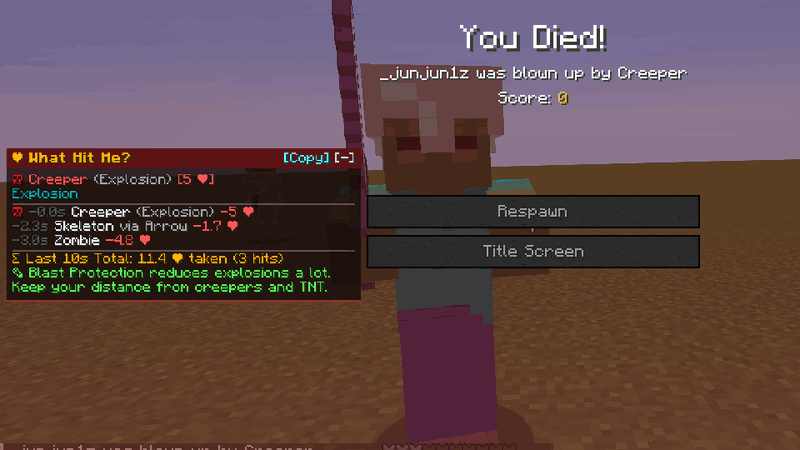
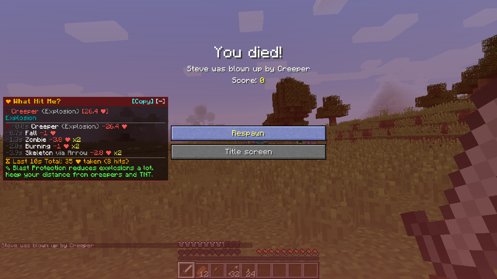

# What Hit Me?

A Minecraft mod for Forge, Fabric and NeoForge (1.7.10 - 26.3) that shows exactly what killed you. **Works in any modpack, with any combination of mods — no required dependencies.**



[日本語版 README](README.ja.md)

Download: [Modrinth](https://modrinth.com/mod/what-hit-me) · [CurseForge](https://www.curseforge.com/minecraft/mc-mods/what-hit-me) · [GitHub Releases](https://github.com/junjun1z/what-hit-me/releases). Full documentation (English / Japanese): [wiki](https://what-hit-me-wiki.vercel.app/).



- Minecraft 1.7.10 - 26.3: Forge, Fabric (needs Fabric API; Mod Menu optional) and NeoForge, 63 builds. The full table is in [docs/description.md](docs/description.md#supported-versions).
- Mod id `whathitme`
- Client, server, or both. No blocks or items. Forge / NeoForge: standard events only, no Mixins or coremods. Fabric: Fabric API events plus a few tiny Mixins where no event exists.
- License: MIT

## Design

- Only players are tracked: every damage and death handler returns on its first line for other entities. Fake players are ignored.
- No server tick handlers. Time windows, merging, reflected damage and cooldowns compare timestamps; checks that must wait for the end of a hit are queued once on the server task queue.
- Packets only on death, totem / heavy hit and commands. Never per hit.
- Smart catalog cache: damage types, mobs and effects are scanned once and saved with a SHA-256 of the sorted `modid:version` list. Same mod list on the next start: loaded from the cache. Different list or `/whm reload`: rescanned.
- Every event hook, packet handler, scan and screen catches its own errors and null values and falls back to "unknown", so a broken damage source, entity, item or text from another mod is not passed on as a crash.
- History is a fixed-size ring buffer per player of immutable records (primitives and strings, no entity references), dropped on logout.

## Features

- **Death screen panel**: killing blow, death message, damage properties, every hit from the last 30 seconds, "Last 10s Total" and a tip. Hover for details. Drag the header to move it, `[-]` to minimize, mouse wheel to scroll, `[Copy]` to copy the recap.
- **Respawn chat summary** in your own chat: killing blow, properties, total of the last 10 seconds, tip, link to the full recap. `/whm togglechat` turns it off.
- **Damage history** (`/whm`): recent hits, alive or dead. Repeated damage from the same source within 3 seconds is merged into one line (`x12 hits`).
- **Hover details**: damage before / after armor, mitigation %, absorption used, health after the hit, attacker weapon and enchantments, distance, `[Invisible]` attacker, owner of turrets / pets / arrows, source mod, internal damage id. `[Copy ID]` and `[Mute]` buttons.
- **Max HP share**: `[-12.0 ❤ (30% Max HP)]`, from the max health at the time of the hit.
- **Environment context**: for damage without an attacker, the block / fluid at the feet and at the body and the items in both hands, each with its mod. Merged repeated damage reads the world only on its first hit.
- **Reflected damage**: thorns, or damage from an entity the player hit within the last 50 ms, gets `[⚡ Reflected / Thorns]` and an automatic tip.
- **Armor break**: `[⚠ Broken: <armor>]` in the timeline when an armor piece breaks.
- **Totem and revive snapshots**: when a Totem of Undying saves you, another mod cancels your death or restores your health after it, or one hit takes 80% of your max health, the moment is saved and a chat alert with `[Details]` appears (`/whm snapshot`).
- **Health-overhaul mods**: a death with total health still above zero (First Aid style) is marked `[Localized / Vital Hit (Died with X.X ❤ total HP left)]`; a death without any damage event before it (`setHealth(0)`) still gets a killing blow from the death event.
- **`[Copy Recap]`** as Markdown, with dimension, coordinates (optional), max health, armor with enchantments and break state, and effects.
- **Stats** (`/whm stats`): total deaths, total damage taken, top 5 causes.
- **Effects** (`/whm effects`): active effects with mod, level, time left and `[Milk ✔]` / `[Milk ✖]`.
- **Search** (`/whm search`): damage types, mobs and effects by `#bypasses_armor`, `#absolute`, `#magic`, `#fire`, `#explosion`, `#projectile`, `#damage`, `#scanned`, `#mob`, `#effect`, `#debuff`, `@modid` or text. Terms can be combined (`@minecraft zombie`).
- **Damage id scanner**: mod damage ids are listed before anyone takes that damage (see below).
- **Settings screen**: `/whm config` opens it on every version and loader; also in the mods list (Forge / NeoForge) and in Mod Menu (Fabric, when installed). Keys locked by the pack are drawn disabled.
- **Automatic tips** by damage type and properties, replaceable per damage id.
- **Templates** (1.3.0): rewrite the hover details, panel / history lines, respawn summary, alerts and copy text with `{variables}`, in the in-game **template editor** with a live preview (`/whm template`).
- 10 languages.

Older Minecraft fonts cannot render emoji, so the mod uses symbols the game font has (☠ ⚠ ❤ ⚡ Σ) and text labels.

## Install modes

| Installed on | What players get |
|---|---|
| Client and server | Accurate data from the server (raw damage, mitigation %, absorption, weapon, owner, shield and i-frame flags, armor, environment), text in the player's language, clipboard buttons. The server's `whathitme-common.cfg` and pack folder apply to everyone. |
| Client only | Client fallback: the client compares its own health and, only when it drops, guesses the cause (fall, lava, fire, drowning, suffocation, void, nearby mob, projectile, explosion, poison, wither, starvation). Entries are marked `[Client Est.]`. `/whm inspect` is not available. |
| Server only | Players without the mod (even plain Forge clients) get English chat: respawn summary, totem / heavy-hit alerts and every `/whm` command. `[Copy ID]` puts the id into the chat box. `togglechat` and `ignore` are stored per player. |

Single player counts as "client and server". On mixed servers each player gets the best mode their client supports. Features turned off on the server (common config or `lockedFeatures`) are removed from the packets the server builds. Clients of 1.0 - 1.2 keep working with a 1.3 server and the other way round. A server can require the mod on every client with `requireClientMod`.

## For modpack makers

### Why include it

- Fewer "what killed me?" questions: players see the attacker, its mod and the damage type themselves.
- Guide players through your pack's dangers with your own tips and names, matched by damage type, attacker, weapon and dimension. Hide noise.
- Keep secrets until players get there (1.3.0): a boss shows as `???` without a tip until its quest, advancement or stage is done. FTB Quests, Better Questing, Heracles, Game Stages, KubeJS and CraftTweaker are supported, all optional.
- Make it look like your pack (1.3.0): templates for every text, custom death messages, and an in-game editor for the whole setup.
- No dependencies, no world data, nothing in chat on join. Safe to add or remove at any time.

### Files

```
config/whathitme/
  whathitme-common.cfg    pack and server settings
  whathitme-client.cfg    personal settings and panel layout
  whathitme-client-templates.json   personal templates (1.3.0)
  hint_template.cfg       written by /whm dump
  pack/                   pack definitions: hints/ renames/ ignored/ triggers/ custom/ templates/ deathmessages/ rules/ (any *.json, any subfolder)
  .cache/                 catalog_cache.json, stats_<uuid>.json, whathitme_dump.csv
  .backup/                previous versions of files changed by the pack editor (1.3.0)
```

| File | For | Contents |
|---|---|---|
| `whathitme-common.cfg` | Pack makers, server owners | Display switches, tip switches, filters (`ignoredDamageIds`, `renameMap`, `hintMap`, `minDamageThreshold`, `heavyHitThreshold`) and tracking (`historySize`, `mergeWindowSeconds`, `summarySeconds`, `recapSeconds`, `maxSnapshots`). A server with the mod sends its file to every modded client on login and after a reload or config change; it replaces the client's own common file. |
| `whathitme-client.cfg` | Each player | The same display switches and filters for personal use, `showHints`, plus the panel layout (`anchorPoint`, `offsetX`, `offsetY`, `scale`, `backgroundOpacity`, `maxVisibleLines`, `minimized`, `chatHistoryLines`). |

Both `.cfg` files use the Forge configuration format on every loader and are re-read by `/whm reload`. An element is shown only when it is `true` in **both** files. Personal renames and tips are applied on top of the pack's. Priority: `.cfg` entries > pack JSON > built-in automatic tips.

<details>
<summary>All settings</summary>

**Display switches** (both files, category `display`, all default `true`):
`enableDeathScreenPanel`, `enableRespawnChatSummary`, `enableTotemChatAlert`, `enableHeavyHitSnapshot`, `showTimestamp`, `showDamageAmount`, `showMitigationDetails`, `showSmartMergeHitCount`, `showSourceModName`, `showDamageProperties`, `showInternalDamageId`, `showAttackerName`, `showAttackerWeapon`, `showAttackerDistance`, `showAttackerInvisibility`, `showEntityOwner`, `showActionButtons`, `showToggleChatNotice`, `showMaxHpPercentage`, `showEnvironmentContext`, `showReflectedBadge`, `showArmorBreakEvents`, `includeEquipmentInCopy`, `includeCoordsInCopy` (needs `includeEquipmentInCopy`).

**Tips** (category `display`, default `true`): `enableAutoHints` and `enableCustomHints` (common file only), `showHints` (client file only). They replace `showHintsAndTips` of 1.0 / 1.1: an old `showHintsAndTips=false` turns all three off, then the old key is removed.

**Filters** (both files, category `filters`):

| Key | Default | Meaning |
|---|---|---|
| `minDamageThreshold` | 0.05 | Damage below this is not recorded |
| `heavyHitThreshold` | 0.8 | A hit taking this part of max health is a heavy hit |
| `ignoredDamageIds` | empty | Keys to hide (composite keys, `*` wildcard) |
| `renameMap` | empty | `key = Name` or `key = lang:translation.key` |
| `hintMap` | empty | `key = Tip` or `key = lang:translation.key` |

The thresholds in `whathitme-client.cfg` only matter in client-only mode; otherwise the server records the damage.

**Tracking** (common file only, category `tracking`):

| Key | Default | Meaning |
|---|---|---|
| `historySize` | 50 | Records kept per player (5-500) |
| `mergeWindowSeconds` | 3.0 | Merge window for repeated damage (0 = off) |
| `summarySeconds` | 10 | Window of "Last Xs Total" |
| `recapSeconds` | 30 | How far back a death recap goes |
| `maxSnapshots` | 5 | Totem / heavy-hit snapshots per player |
| `requireClientMod` | false | 1.3.0: refuse players whose client does not have What Hit Me? |

**Layout** (client file only, category `layout`):

| Key | Default | Meaning |
|---|---|---|
| `anchorPoint` | `CENTER_LEFT` | `TOP_LEFT`, `TOP_RIGHT`, `BOTTOM_LEFT`, `BOTTOM_RIGHT`, `CENTER_LEFT`, `CENTER_RIGHT` |
| `offsetX` / `offsetY` | 4 / 0 | Offset from the anchor, saved when you drag the panel |
| `scale` | 0.85 | Panel scale |
| `backgroundOpacity` | 0.75 | 0.0 - 1.0 |
| `maxVisibleLines` | 8 | Lines before scrolling |
| `minimized` | false | Saved by the `[-]` button |
| `chatHistoryLines` | 15 | Lines shown by `/whm history` |

</details>

### Pack folder

If `config/whathitme/pack/` is missing, it is created with `hints/`, `renames/`, `ignored/`, `triggers/`, `custom/`, `templates/`, `deathmessages/` and `rules/`, each with an `_example.json` whose entries are commented out (nothing happens until you edit them). Every `.json` below `pack/` is read in alphabetical path order (or by a top-level `"order"` number) and merged; later files override earlier entries. `"enabled": false` skips a file. Comments (`//`, `/* */`) and trailing commas are allowed. Any file may contain any of the keys:

```json
{
  "renameMap": {
    "minecraft:outOfWorld": "&5The Abyss",
    "mob:minecraft:zombie @item:minecraft:iron_sword": "Armed Zombie"
  },
  "hintMap": {
    "minecraft:lava @dim:minecraft:the_nether": "Carry Fire Resistance potions in the Nether.",
    "mob:lycanitesmobs:*": "lang:mypack.hint.lycanites"
  },
  "defaultIgnoredDamageIds": ["minecraft:cactus"],
  "lockedFeatures": ["showInternalDamageId"],
  "deathTriggers": [
    { "match": "minecraft:lava", "command": "say {player} fell into lava at {x} {y} {z}", "cooldownSeconds": 60 },
    { "match": "mob:minecraft:creeper", "command": "give {player} minecraft:bread 4", "oncePerPlayer": true }
  ]
}
```

- `renameMap`, `hintMap`: objects (`"key": "value"`) or lists of `"key = value"` strings. An empty value removes an entry of an earlier file. `&` color codes work. `lang:<translation.key>`, or a value that is itself a translation key, is translated on each player's client, so a resource pack can provide the text in every language.
- `defaultIgnoredDamageIds`: keys hidden for everyone.
- `lockedFeatures`: config keys that cannot be changed from the settings screen or `/whm config`, even in single player.
- `deathTriggers`: see below.
- `templates`, `deathMessages`, `rules` (1.3.0): see below.
- `order`, `enabled`, `memo`, `entryMemos` (1.3.0): load order, on / off switch and notes, written by the pack editor.
- `/whm reload` re-reads the folder and reports the number of files read, any file that could not be parsed (that file is skipped), unknown template variables and rule problems.

### Composite match keys

Used by `renameMap`, `hintMap`, `ignoredDamageIds`, `defaultIgnoredDamageIds` and `deathTriggers`. Conditions in any order, separated by spaces (or `&`):

| Condition | Matches |
|---|---|
| `minecraft:lava`, `mob:minecraft:zombie` | Damage id: `mob:<entity id>` for attacks by an entity, `<modid>:<damage type>` for everything else (`minecraft:fall`, `minecraft:outOfWorld`, `minecraft:explosion.player`) |
| `@minecraft:zombie`, `@mob:minecraft:zombie` | The attacker's entity id |
| `@item:minecraft:iron_sword` | The item in the attacker's main hand |
| `@dim:minecraft:the_nether` | The dimension (`the_nether` without namespace also matches) |

Every condition may use `*` and `?` wildcards. Conditions can also be written without a separator in front of an `@`, so `*@twilightforest:lich` (any damage from the Lich, whatever its id) and `minecraft:arrow@twilightforest:skeleton_druid` work too. Useful patterns:

| Key | Matches |
|---|---|
| `*@twilightforest:lich` or `@twilightforest:lich` | Every hit by the Lich, whatever damage id its attacks use |
| `@twilightforest:*` | Any attacker from Twilight Forest |
| `*acid*` | Every damage id that contains "acid" (for ids a mod builds at run time) |
| `minecraft:arrow @twilightforest:skeleton_druid` | Only that mob's arrows |

All conditions of a key must match. When several keys match, the most specific one wins: the key with more conditions (a bare `*` does not count), and on a tie the one with fewer wildcards. So a tip for `twilightforest:lich_bolt @twilightforest:lich` beats a general tip for `@twilightforest:lich`, and `*` alone works as a catch-all with the lowest priority.

### Death triggers

Each entry of `deathTriggers` has `match` (composite key), `command`, and optionally `oncePerPlayer` (default `false`; remembered in the player's stats file) and `cooldownSeconds` (per player, default `0`). Placeholders: `{player}`, `{x}`, `{y}`, `{z}` (block position of the death), `{damage}` (health points of the killing blow, one decimal), and since 1.3.0 every template variable. 1.3.0: `if` / `any` / `unless` conditions (see progression rules). Commands run on the server only, with console permission; every matching trigger runs, in file order. A leading `/` is optional.

### Templates (1.3.0)

Rewrite what the mod shows, line by line. Outputs: `hover` (hover details, also of history and chat lines), `line` (death screen panel line and `/whm history` line), `summary` (respawn chat), `alert` (totem / heavy-hit alerts), `copy` (`[Copy]` recap).

```json
{
  "templates": {
    "summary": [
      "&6&l===== {player} died =====",
      "&cKilled by &f{killing_blow} &c({damage} ❤)",
      "&7Weapon: {weapon}",
      "&aTip: {tip}",
      "&b{recap_link}"
    ]
  }
}
```

- `{variable}`, `{variable|fallback}`, `{damage:2}` (decimals), `&` colors, `lang:<key>` lines. A line whose placeholders are all empty is dropped ("Weapon:" disappears without a weapon).
- Variables follow the display switches: a variable that is turned off (or hidden by a rule) is empty, so templates never show what the server disabled.
- Priority: personal `whathitme-client-templates.json` > pack `templates` > built-in (exactly the 1.2.0 output in every language). Lock an output with `lockedFeatures`: `templates` or `templates.<output>`.
- **Template editor**: `/whm template` or **Templates...** in the settings screen. Live preview drawn by the real output code, clickable variable list, your latest death or a sample death. **Save to pack** (single player with cheats) writes `pack/templates/<output>.json`. `/whm template preview <output>` prints a template in chat.

### Custom death messages (1.3.0)

`deathMessages` replaces the vanilla death message for matching deaths (off by default, no entries = no change). Keys are composite keys, values are one-line templates:

```json
{
  "deathMessages": {
    "mekanism:acid": "{player} dissolved in acid",
    "*@twilightforest:lich": "{player} was outsmarted by the Lich"
  }
}
```

| Server | Players with the mod | Players without the mod |
|---|---|---|
| Fabric | Custom message | Custom message |
| Forge / NeoForge | Custom message (chat and death screen) | Vanilla message (use `requireClientMod`) |

The server log shows the custom text. `lang:` keys are translated per player.

### Progression rules (1.3.0)

`rules` change the name and tip, hide fields and run commands depending on the player's progress. The first matching rule wins:

```json
{
  "rules": [
    {
      "match": "*@twilightforest:lich",
      "unless": ["advancement:twilightforest:progress_lich"],
      "name": "&k???",
      "hint": "",
      "hide": ["damage_id", "attacker", "mod", "weapon", "death_message"]
    }
  ]
}
```

- Fields: `match`, `if` (all), `any` (one of), `unless` (none), `name`, `hint` (`""` = no tip), `hide`, `enforce` (personal renames / tips / templates do not apply; on when `hide` is set), `commands`, `oncePerPlayer`, `cooldownSeconds`.
- `hide`: `damage_id`, `attacker`, `mod`, `weapon`, `death_message`, `tip`, `properties`, `environment`, `owner`, `distance`, `position`. Hidden data is removed on the server before anything is sent. A hidden death message becomes "{player} was killed by ???" or "{player} died".
- Conditions (`!` negates): `advancement:<id>` (1.12+), `tag:<tag>` (1.9+), `score:<objective><op><n>`, `stage:<name>` (Game Stages), `ftbquests:<id>` (FTB Quests), `bq:<id>` (Better Questing, also GTNH), `heracles:<id>` (Heracles / Odyssey Quests), `script:<name>` (scripts). Quest mods are optional; each one is tested on every version and loader it exists for.
- Rules are checked every time an output is built, so finishing a quest reveals old entries too. They need the mod on the server.
- `/whm test <damage_id> ... --as <player> --assume <condition>` shows the result for a player's real progress.

### `requireClientMod` (1.3.0)

`requireClientMod=true` in `whathitme-common.cfg` refuses players without What Hit Me? with a readable message (only presence is checked, not the version). On Forge / NeoForge, servers whose rules hide death messages log a warning while it is off, because vanilla clients still see the vanilla message there.

### Script integration (1.3.0)

KubeJS, CraftTweaker and MineTweaker 3 scripts, on every version and loader where these script mods exist (KubeJS 1.12.2 - 26.1.2, CraftTweaker 1.12.2 - 1.21.1, MineTweaker 3 / CraftTweaker 3.x 1.7.10 - 1.11.2):

```js
// kubejs/server_scripts/whathitme.js
WhatHitMeEvents.register(event => {
  event.condition('veteran', 'Has killed the Wither', player => player.stages.has('wither_down'))
  event.addRule({ match: '*@minecraft:wither', unless: ['script:veteran'], name: '???', hide: ['attacker', 'mod'] })
})
```

Script conditions (`script:<name>`), template variables (`{script:<name>}`), events (`damageRecorded`, `death`, `respawn`, `alert`), read access (last death, history, stats, `/whm test` results) and runtime renames / tips / rules / death messages / templates. Everything is rebuilt on `/whm reload` and on the script mod's reload. Java API for other mods: `io.github.junjun1z.whathitme.api.WhatHitMeApi`.

### In-game pack editor (1.3.0)

`/whm pack` (or **Pack editor...** in the settings screen) edits everything above in game: renames, tips, rules, death messages, templates, death triggers, ignored ids, locked features and the server settings. For single player with cheats and operators.

- The server checks each edit, writes the JSON file, reloads at once and updates every player. Saved when an entry is confirmed, not per keystroke.
- Each JSON file is a category, sub-folders are groups; order, on / off and memos are stored in the files. Hand-written comments in a file the editor rewrites are lost: use the memo fields.
- Match key builder with searchable damage id / mob lists, condition picker with the server's advancements, scores, tags, quests, stages and script conditions, preview "as player / assuming conditions", inline errors, a notice when another operator saves.
- Backups in `config/whathitme/.backup/`, 30 undo steps.
- Personal mode (`/whm pack personal`, no permission needed): your own renames, tips and ignored ids as lists.

### `/whm test`

`/whm test <damage_id> [entity_id] [item_id] [dim_id] [--as <player>] [--assume <condition>]` (op) builds a dummy killing blow and shows the resulting name, tip, the matching rule and hidden fields, the death triggers that would run (with placeholders filled in, not run), the death message and the chat preview. `-` skips an argument; the dimension defaults to the caller's.

### Damage id scanner and `/whm dump`

Mod damage ids are listed before anyone takes that damage:

- 1.7.10 - 1.19.3: after a cache miss (first start, mod list changed, `/whm reload`) a daemon thread reads the class files of the mod jars (no class loading) and collects the string ids passed to the damage source constructors, including subclasses and setter calls right after the constructor. Nested jars are read one level deep. The result is stored under `scan` in `catalog_cache.json`.
- 1.19.4+: every key of the game's damage type registry is listed, with flags from its tags; no scan is needed.

The ids show in `/whm search` (`#scanned`), `/whm test` completion and `/whm dump`. `/whm dump` (op) writes:

1. `config/whathitme/.cache/whathitme_dump.csv`: every damage type, mob and effect with mod, properties, times seen, your custom name / tip / ignore, and `source` (`seen`, `scanned` or `registry`).
2. `config/whathitme/hint_template.cfg`: `S:hintMap <...>` and `S:renameMap <...>` blocks with every known damage id and `mob:<id>` for every registered mob, each with an empty value. Paste them into `whathitme-common.cfg` and fill in what you need; empty values are ignored.

### Stats

`/whm stats` counts deaths per cause and the health actually lost. Up to 100 causes per player in memory; saved to `.cache/stats_<uuid>.json` only on death, logout and world save.

### Can I include it in my modpack?

Yes. MIT license, no need to ask.

## Commands

`/whm` (alias `/whathitme`), everything Tab-completes. "Op" = permission level 2, or single player with cheats enabled.

| Command | What it does | Who |
|---|---|---|
| `/whm` or `/whm history` | Recent damage taken | Everyone |
| `/whm last` | Full recap of your last death | Everyone |
| `/whm snapshot [n]` | Saved totem / heavy-hit snapshots (1 = newest) | Everyone |
| `/whm effects` | Active effects, mod, milk curability | Everyone |
| `/whm stats` | Deaths per cause, total deaths, damage taken | Everyone |
| `/whm search <text\|#tag\|@modid>` | Search damage types, mobs and effects | Everyone |
| `/whm togglechat` | Respawn chat summary on / off | Everyone |
| `/whm ignore <id>` | Hide / show a damage id | Everyone (personal); op for the server list |
| `/whm config` | Open the settings screen (lists the settings for players without the mod) | Everyone |
| `/whm config <key> [value]` | Show or change a setting (`true`/`false`/`on`/`off`/`toggle`) | Personal keys: everyone; common keys: op |
| `/whm rename <id> <name...>` | Custom name (empty removes it) | Op |
| `/whm sethint <id> <tip...>` | Custom tip (empty removes it) | Op |
| `/whm inspect <player>` | Last death and history of an online player | Op |
| `/whm test <damage_id> [entity] [item] [dim] [--as <player>] [--assume <cond>]` | Preview name, tip, rules, death triggers, death message and chat | Op |
| `/whm dump` | Write `whathitme_dump.csv` and `hint_template.cfg` | Op |
| `/whm reload` | Reload config files and pack folder, rescan the catalog | Op |
| `/whm template` | Open the template editor (1.3.0) | Everyone (modded client) |
| `/whm template preview <output>` / `reset [output]` | Show a template in chat / delete your personal templates (1.3.0) | Everyone |
| `/whm pack` | Open the pack editor (1.3.0) | Op (needs the mod on the server) |
| `/whm pack personal` | Pack editor for your own renames, tips and ignored ids (1.3.0) | Everyone (modded client) |
| `/whm server <subcommand>` | From a modded client: run it on the server | Needs the mod on the server |
| `/whm help` | Command list | Everyone |

Keys in `lockedFeatures` cannot be changed by anyone. From a modded client, `rename` / `sethint` edit your personal file; `/whm server rename ...` edits the server's common file. `/whm copy` and `/whm copyrecap` are used internally by the `[Copy ID]` and `[Copy Recap]` buttons.

## Languages

English, 日本語, 简体中文, 繁體中文, 한국어, Русский, Deutsch, Français, Español, Português (Brasil).

`python tools/check_lang.py` lists keys missing or extra in each language compared to `en_us.json`.

## Building

Requires JDK 25 to run Gradle; the Java 8 / 17 / 21 / 25 toolchains of the targets are downloaded automatically.

```
./gradlew collectJars -Pmod_version=1.3.0
```

Every Minecraft version / loader is one target; all jars are copied to `build/dist/`. Layout, architecture, how to add a version, porting notes and the in-game self-test: [BUILD.md](BUILD.md).

Releases: pushing a tag such as `1.3.0` runs `.github/workflows/release.yml`, which builds every target and publishes the jars listed in `publish.json` to GitHub Releases, Modrinth and CurseForge with the matching section of [CHANGELOG.md](CHANGELOG.md).

## License

[MIT](LICENSE) © junjun1z
