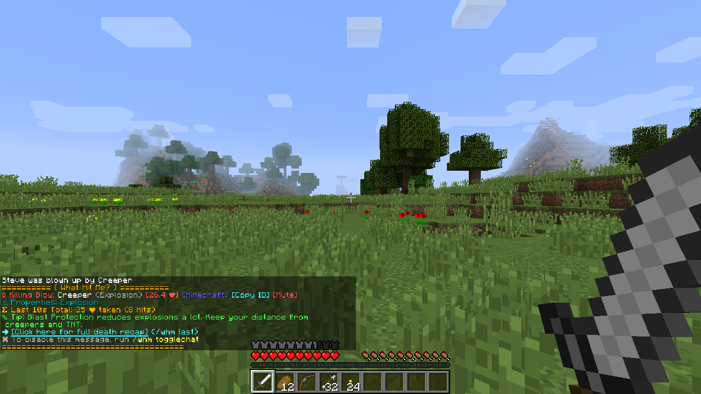
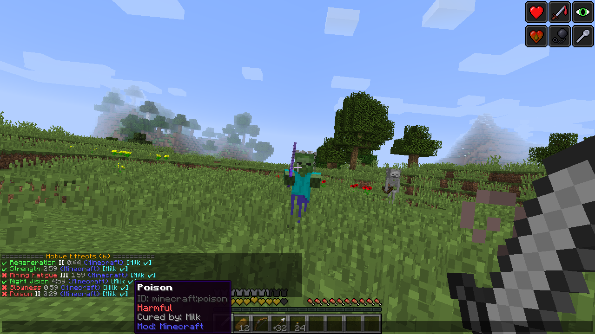
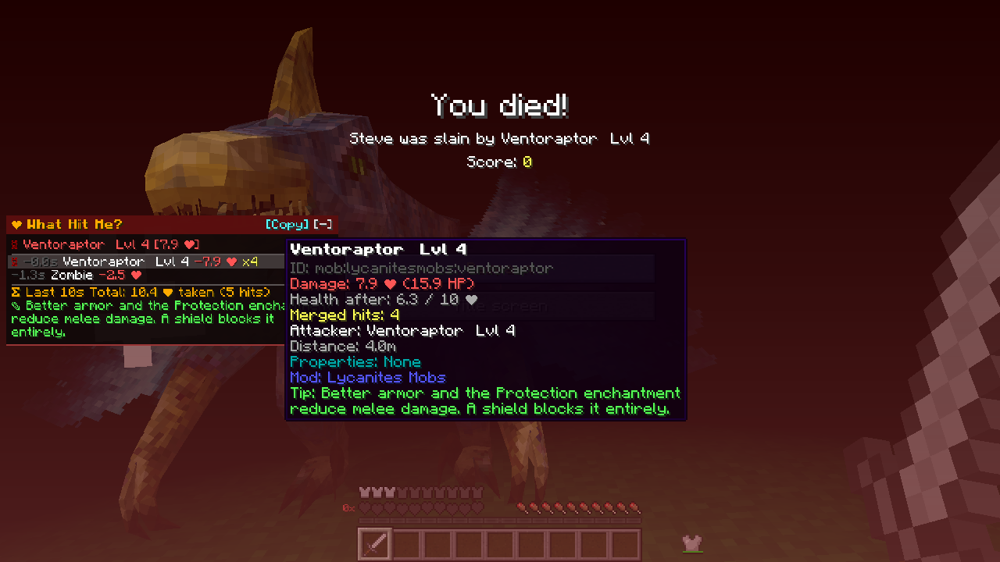

# What Hit Me?

See exactly what killed you. **Works in any modpack, with any combination of mods — no required dependencies.**

What Hit Me? records the damage a player takes and explains a death in plain words: the killing blow, the attacker and its mod, how much armor helped, whether the damage ignored armor, and what to do about it next time. It runs on the client, on the server, or both, adds no blocks or items, uses no Mixins or coremods, and only does work for players.


## What it shows

- **Death screen panel.** A recap next to the vanilla death screen: killing blow, death message, damage properties, every hit from the last 30 seconds, the "Last 10s Total" and a tip. Hover a line for details. Drag the header to move it, `[-]` to minimize, mouse wheel to scroll, `[Copy]` to copy the recap.
- **Respawn chat summary.** After respawning, a short summary in your own chat only: killing blow, properties, total damage in the last 10 seconds, a tip and a link to the full recap. Turn it off with `/whm togglechat`.
- **Damage history.** `/whm` lists recent hits, alive or dead. Repeated damage from the same source (fire, poison, a cactus) is merged into one line with a hit counter (`x12 hits`).
- **Details on hover.** Damage before and after armor, mitigation %, absorption (yellow hearts) used, health after the hit, attacker weapon and enchantments, distance, invisible attacker, owner of turrets, pets and arrows, the mod that added it, and the internal damage id.
- **Totem and heavy-hit snapshots.** When a Totem of Undying saves you, another mod prevents your death, or one hit takes 80% of your max health, the moment is saved and a chat alert with a `[Details]` link appears. `/whm snapshot` shows them later.
- **Effects.** `/whm effects` lists active potion effects with their mod, level, time left and whether milk cures them (`[Milk ✔]` / `[Milk ✖]`).
- **Search.** `/whm search` finds damage types, mobs and effects in your pack: `#bypasses_armor`, `#magic`, `#fire`, `#explosion`, `#projectile`, `#absolute`, `@modid`, or plain text.

| Respawn chat | History | Effects |
|---|---|---|
|  |  |  |

| Search | Totem alert |
|---|---|
|  |  |

| In a 21-mod pack | In-game settings |
|---|---|
|  |  |

## For modpack makers

### Why include it

- Fewer "what killed me?" questions in your Discord and issue tracker. Players see the attacker, the mod and the damage type themselves.
- Guide players through your pack's dangers. Write your own tip for any damage id or mob (`hintMap`), rename confusing damage types (`renameMap`), and hide noise (`ignoredDamageIds`).
- Safe to add late: no dependencies, no world data, no blocks or items, nothing in chat on join. Remove it any time.

### Install modes

| Installed on | Works | What players get |
|---|---|---|
| Client and server | Yes | Full, accurate data from the server: damage before armor, mitigation %, absorption, weapon, owner, shield and i-frame flags. Text in the player's language. Clipboard buttons. The server's `whathitme-common.cfg` applies to everyone. |
| Client only | Yes | Client fallback on servers without the mod: the client watches its own health and guesses the cause (fall, lava, fire, drowning, void, nearby mob, projectile, explosion, poison, wither, starvation). Entries are marked `[Client Est.]`. `/whm inspect` is not available. |
| Server only | Yes | Players without the mod (even plain Forge clients) get readable English chat: respawn summary, totem / heavy-hit alerts and all `/whm` commands. `[Copy ID]` puts the id into the chat box instead of the clipboard. |

Single player counts as "client and server". Mixed servers work too: each player gets the best mode their client supports.

### Config files

Both files are in `config/whathitme/` and are re-read by `/whm reload` without a restart. You can also edit them in game: **Mods → What Hit Me? → Config** (Personal and Modpack / server groups).

| File | Who it is for | Contents |
|---|---|---|
| `whathitme-common.cfg` | Pack makers and server owners | Display switches, `ignoredDamageIds`, `renameMap`, `hintMap`, thresholds, and tracking settings (`historySize`, `mergeWindowSeconds`, `summarySeconds`, `recapSeconds`, `maxSnapshots`). On a server with the mod, this file is sent to every client on login and replaces the client's own common file. |
| `whathitme-client.cfg` | Each player | The same display switches and lists for personal use, plus the death screen panel layout (`anchorPoint`, `offsetX`, `offsetY`, `scale`, `backgroundOpacity`, `maxVisibleLines`, `chatHistoryLines`). |

An element is shown only when it is `true` in **both** files, so a pack or server can turn something off for everyone, and each player can turn off more for themselves. Players can add their own renames and tips on top of yours.

### Custom tips and names

In `whathitme-common.cfg`, category `filters`:

```
S:hintMap <
    mob:minecraft:creeper = Creepers hiss before exploding - sprint away!
    minecraft:outOfWorld = Build railings near the edge. Nothing protects from the void.
    mob:lycanitesmobs:* = Check the Beastiary for this mob's weaknesses.
 >

S:renameMap <
    minecraft:outOfWorld = &5The Abyss
    draconicevolution:chaos = lang:mypack.damage.chaos
 >
```

- Ids are `mob:<entity id>` for attacks by an entity and `<modid>:<damage type>` for everything else. `*` wildcards work.
- `&` color codes work in names and tips.
- **Localization:** a value of `lang:<translation.key>` is translated on each player's client. Ship the keys in a resource pack (or with a resource loader mod) and every language gets its own tip.
- Damage ids without a `hintMap` entry get an automatic tip from their type and properties.

You can also set them in game: `/whm rename <id> <name>` and `/whm sethint <id> <tip>` (run as `/whm server ...` from a modded client to write the server's common file; needs op).

### Finding every damage id: `/whm dump`

1. Run `/whm dump` in a world with your pack (as op on a server).
2. It writes `whathitme_dump.csv` (every damage type seen, every mob and effect, their mod and properties, and your current settings) and `config/whathitme/hint_template.cfg`.
3. `hint_template.cfg` contains ready-to-paste `S:hintMap <...>` and `S:renameMap <...>` blocks listing every vanilla damage type, every damage id seen in the world and `mob:<id>` for every registered mob, each with an empty value.
4. Paste the blocks into `whathitme-common.cfg` and fill in the lines you care about. Lines with an empty value are ignored, so you can fill them in gradually.

Damage types from mods appear in the dump after they have hit someone at least once in that world.

### Performance

- Only players are tracked. The damage handlers return on their first line for any other entity, so mob fights cost nothing. Fake players are ignored.
- No per-tick work on the server beyond an empty-list check.
- History is a fixed-size ring buffer per player (`historySize`, default 50) of small immutable records with no entity references. It is dropped when the player logs out.
- Network packets are sent only on death, totem / heavy hit, and when a player runs a command. Never per hit.

### Can I include it in my modpack?

Yes. It is MIT licensed. No need to ask.

## Commands

All commands are `/whm` (alias `/whathitme`) and Tab-complete.

| Command | What it does | Who |
|---|---|---|
| `/whm` or `/whm history` | Recent damage taken | Everyone |
| `/whm last` | Full recap of your last death | Everyone |
| `/whm snapshot [n]` | Saved totem / heavy-hit snapshots (1 = newest) | Everyone |
| `/whm effects` | Active effects, their mod, and whether milk cures them | Everyone |
| `/whm search <text\|#tag\|@modid>` | Search damage types, mobs and effects | Everyone |
| `/whm togglechat` | Respawn chat summary on / off | Everyone |
| `/whm ignore <id>` | Hide / show a damage id | Everyone (personal); op for the server list |
| `/whm rename <id> <name...>` | Custom display name (empty removes it) | Client: personal; server: op |
| `/whm sethint <id> <tip...>` | Custom tip (empty removes it) | Client: personal; server: op |
| `/whm config [key] [value]` | List, show or change a setting | Client: personal; server: op |
| `/whm inspect <player>` | Last death and history of an online player | Op (level 2) |
| `/whm dump` | Write `whathitme_dump.csv` and `hint_template.cfg` | Client: everyone; server: op |
| `/whm reload` | Reload the config files | Client: everyone; server: op |
| `/whm server <subcommand>` | From a modded client: run the subcommand on the server (server-wide settings) | Needs the mod on the server |
| `/whm help` | Command list | Everyone |

## Languages

English, Japanese, Simplified Chinese, Traditional Chinese, Korean, Russian, German, French, Spanish, Brazilian Portuguese.

Players without the mod see English text sent by the server.

## FAQ

**Does it need anything else?**
No. Minecraft 1.12.2 and Forge 14.23.5.2847 or newer.

**Do players have to install it?**
No. On a server with the mod, players without it still get the chat summary and commands in English. Installing it on the client adds the death screen panel, translations and clipboard buttons.

**Can I use it on a server that does not have it?**
Yes. The client estimates the damage from its own health and nearby entities. Those entries are marked `[Client Est.]` and are less detailed.

**Will it conflict with other mods?**
It uses only standard Forge events. No Mixins, no coremods, no replaced screens: the panel is drawn on top of the vanilla death screen.

**The chat summary is too much. How do I turn it off?**
`/whm togglechat`, or set `enableRespawnChatSummary=false`. Pack makers can turn off any element for everyone in `whathitme-common.cfg`.

**Why does it say "Unknown" or `unknown:` for some damage?**
Some mods create damage without a type the game can trace back to them. Use `renameMap` to give it a name.

**Why are there no emoji?**
Minecraft 1.12.2 cannot render them, so the mod uses symbols the game font has (☠ ⚠ ❤) and text labels.
