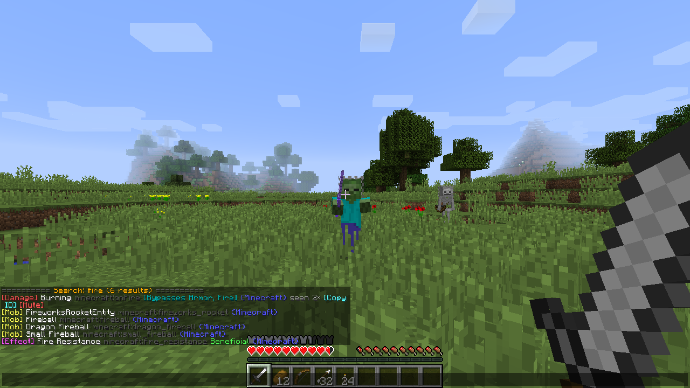

# What Hit Me?

See exactly what killed you. **Works in any modpack, with any combination of mods — no required dependencies.**

What Hit Me? records the damage a player takes and explains a death in plain words: the killing blow, the attacker and its mod, how much armor helped, whether the damage ignored armor, and what to do about it next time. It runs on the client, on the server, or both, and adds no blocks or items. Minecraft 1.7.10 - 26.3 on Forge, Fabric and NeoForge: 63 builds, each one started and tested in game.


## Built to stay out of the way

- **Only players are tracked.** Every damage and death handler returns on its first line for any other entity, so mob fights are not touched.
- **No server tick handlers.** Time windows, merging, reflected damage and cooldowns compare timestamps; the few checks that must wait for the end of a hit are queued once on the server's task queue.
- **Network traffic only when there is something to show:** on death, on a totem / heavy hit, and when a player runs a command. Never per hit.
- **Smart mod-list cache.** Damage types, mobs and effects are scanned once and saved together with a hash of the mod list. As long as the mods do not change, the next start loads the list from the cache.
- **Every hook is guarded.** Event handlers, packet handlers, scans and screens catch their own errors and fall back to "unknown", so a broken damage source, entity or item from another mod is not passed on as a crash.

## For players

- **Death screen panel.** A recap next to the vanilla death screen: killing blow, death message, damage properties, every hit from the last 30 seconds, the "Last 10s Total" and a tip. Hover a line for details. Drag the header to move it, `[-]` to minimize, mouse wheel to scroll, `[Copy]` to copy the recap.
- **Respawn chat summary.** After respawning, a short summary in your own chat only: killing blow, properties, total damage in the last 10 seconds, a tip and a link to the full recap. Turn it off with `/whm togglechat`.
- **Damage history.** `/whm` lists recent hits, alive or dead. Repeated damage from the same source (fire, poison, a cactus) is merged into one line with a hit counter (`x12 hits`).
- **Details on hover.** Damage before and after armor, mitigation %, absorption used, health after the hit, attacker weapon and enchantments, distance, invisible attacker, owner of turrets, pets and arrows, the mod that added it, and the internal damage id.
- **Damage as a share of max health.** `[-12.0 ❤ (30% Max HP)]` keeps big numbers readable in packs that raise max health.
- **Where it happened.** For damage without an attacker (fire, lava, cactus, modded acid or shock blocks), the hover shows the block or fluid at your feet and body and the items in your hands, each with its mod.
- **Reflected damage.** Thorns, or damage from an entity you hit a moment earlier, gets a `[⚡ Reflected / Thorns]` badge and its own tip.
- **Armor break.** When an armor piece breaks, the timeline shows `[⚠ Broken: Diamond Chestplate]` at that point.
- **Totem and revive snapshots.** When a Totem of Undying saves you, another mod cancels your death or revives you, or one hit takes 80% of your max health, the moment is saved and a chat alert with a `[Details]` link appears. `/whm snapshot` shows them later.
- **Copy for a bug report.** `[Copy Recap]` copies the recap as Markdown, including dimension, coordinates (optional), max health, the four armor pieces with enchantments and break state, and active effects.
- **Your death statistics.** `/whm stats` shows your total deaths, total damage taken and your top 5 causes of death.
- **Effects.** `/whm effects` lists active potion effects with their mod, level, time left and whether milk cures them (`[Milk ✔]` / `[Milk ✖]`).
- **Search.** `/whm search` finds damage types, mobs and effects in your pack: `#bypasses_armor`, `#magic`, `#fire`, `#explosion`, `#projectile`, `#absolute`, `#scanned`, `@modid`, or plain text.
- **Settings screen everywhere.** `/whm config` opens the settings screen on every version and loader. It is also in the mods list on Forge and NeoForge, and in Mod Menu on Fabric when Mod Menu is installed (optional).

| Respawn chat | History | Effects |
|---|---|---|
|  |  |  |

| Search | Totem alert |
|---|---|
|  |  |

| In a 21-mod pack | In-game settings |
|---|---|
|  |  |

## For modpack makers

### Why include it

- Fewer "what killed me?" questions in your Discord and issue tracker. Players see the attacker, the mod and the damage type themselves.
- Guide players through your pack's dangers with your own names and tips, matched by damage type, attacker, weapon and dimension.
- Safe to add late: no dependencies, no world data, no blocks or items, nothing in chat on join. Remove it any time.

### Health-overhaul mods

- The `(30% Max HP)` share is taken from the player's max health at the moment of the hit, so it stays meaningful with mods that change max health.
- If a player dies while their total health is still above zero (body-part health such as First Aid), the recap adds `[Localized / Vital Hit (Died with 4.5 ❤ total HP left)]`.
- A death that arrives without any damage event before it (a mod calling `setHealth(0)`, for example) still gets a killing blow, taken from the death event, so the recap is never empty.

### The pack folder

On first start the mod creates `config/whathitme/pack/` with the subfolders `hints/`, `renames/`, `ignored/`, `triggers/` and `custom/`, each holding an `_example.json` whose entries are commented out. Every `.json` file in the folder and its subfolders is read in alphabetical path order and merged; later files override earlier entries. The folder names are only for your own order: any file may contain any of these keys.

```json
{
  // comments and trailing commas are allowed
  "renameMap": {
    "minecraft:outOfWorld": "&5The Abyss",
    "mob:minecraft:zombie @item:minecraft:iron_sword": "Armed Zombie"
  },
  "hintMap": {
    "minecraft:lava @dim:minecraft:the_nether": "Carry Fire Resistance potions in the Nether.",
    "mob:lycanitesmobs:*": "lang:mypack.hint.lycanites"
  },
  "defaultIgnoredDamageIds": ["minecraft:cactus"],
  "lockedFeatures": ["showInternalDamageId"],
  "deathTriggers": [
    { "match": "minecraft:lava", "command": "say {player} fell into lava at {x} {y} {z}", "cooldownSeconds": 60 },
    { "match": "mob:minecraft:creeper", "command": "give {player} minecraft:bread 4", "oncePerPlayer": true }
  ]
}
```

- `renameMap` / `hintMap`: display names and tips. `&` color codes work. A value of `lang:<key>` (or a plain translation key) is translated on each player's client, so a resource pack can provide the text in every language.
- `defaultIgnoredDamageIds`: damage ids hidden for everyone by default.
- `lockedFeatures`: config keys players cannot change from the settings screen or `/whm config`, even in single player. Locked entries are shown greyed out.
- Priority: entries in the `.cfg` files > pack JSON files > built-in automatic tips. `/whm reload` re-reads everything without a restart and reports how many pack files were read and which ones had errors.

### Composite match keys

`renameMap`, `hintMap`, `ignoredDamageIds`, `defaultIgnoredDamageIds` and `deathTriggers` all use the same keys. Combine any of these conditions, in any order, separated by spaces:

| Condition | Matches |
|---|---|
| `minecraft:lava`, `mob:minecraft:zombie` | Damage id: `mob:<entity id>` for attacks by an entity, `<modid>:<damage type>` for everything else |
| `@minecraft:zombie` or `@mob:minecraft:zombie` | The attacker |
| `@item:minecraft:iron_sword` | The item in the attacker's main hand |
| `@dim:minecraft:the_nether` | The dimension |

Every condition may use `*` wildcards (`mob:lycanitesmobs:*`). All conditions of a key must match; when several keys match, the one with the most conditions wins.

### Death triggers

`deathTriggers` run a server command when a player's death matches `match`:

- Placeholders: `{player}`, `{x}`, `{y}`, `{z}` (block coordinates of the death) and `{damage}` (health points of the killing blow).
- `oncePerPlayer`: only the first matching death of each player (remembered across restarts). `cooldownSeconds`: per player.
- Commands run on the server only, with console permission. Every matching trigger runs, in file order.

### Testing: `/whm test`

`/whm test <damage_id> [entity_id] [item_id] [dim_id]` builds a dummy death and shows the resulting name, the tip, the death triggers that would run (they are not run) and a preview of the chat summary. Use `-` to skip an argument. Arguments Tab-complete, including damage ids found by the scanner.

### Every damage id, before anyone takes it

Mod damage ids are listed before anyone has taken that damage:

- Minecraft 1.7.10 - 1.19.3: the mod reads the class files of the installed mod jars (without loading any classes) and collects the ids passed to damage source constructors. This runs on a background thread on first start, after the mod list changes and on `/whm reload`, and the result is saved in the cache.
- Minecraft 1.19.4 and newer: the game's damage type registry already lists every damage type, so it is read directly.

The ids appear in `/whm search` (`#scanned`), in `/whm test` completion, and in `/whm dump`, which writes `config/whathitme/.cache/whathitme_dump.csv` (every damage type, mob and effect with its mod, properties and source: seen, scanned or registry) and `config/whathitme/hint_template.cfg` with ready-to-paste `S:hintMap <...>` and `S:renameMap <...>` blocks. Lines with an empty value are ignored, so you can paste the whole block and fill it in gradually.

### Install modes

| Installed on | Works | What players get |
|---|---|---|
| Client and server | Yes | Full, accurate data from the server: damage before armor, mitigation %, absorption, weapon, owner, shield and i-frame flags, armor and environment details. Text in the player's language. Clipboard buttons. The server's settings and pack folder apply to everyone. |
| Client only | Yes | Client fallback on servers without the mod: the client compares its own health and, only when it drops, guesses the cause (fall, lava, fire, drowning, void, nearby mob, projectile, explosion, poison, wither, starvation). Entries are marked `[Client Est.]`. `/whm inspect` is not available. |
| Server only | Yes | Players without the mod (even plain Forge clients) get readable English chat: respawn summary, totem / heavy-hit alerts and all `/whm` commands. `[Copy ID]` puts the id into the chat box instead of the clipboard. |

Single player counts as "client and server". Mixed servers work too: each player gets the best mode their client supports. Features turned off on the server (in its common config or through `lockedFeatures`) are removed before the data is sent to clients.

### Files

```
config/whathitme/
  whathitme-common.cfg    pack and server settings (sent to modded clients)
  whathitme-client.cfg    personal settings and panel layout
  hint_template.cfg       written by /whm dump
  pack/                   pack definitions (*.json, any subfolder)
  .cache/                 catalog_cache.json, stats_<uuid>.json, whathitme_dump.csv
```

An element is shown only when it is `true` in **both** `.cfg` files, so a pack or server can turn something off for everyone, and each player can turn off more for themselves. Players can add their own renames and tips on top of yours. Tips have three switches: `enableAutoHints` and `enableCustomHints` (common file) and `showHints` (client file); an old `showHintsAndTips=false` is carried over to all three.

New switches in 1.2 (all default `true`): `showMaxHpPercentage`, `showEnvironmentContext`, `showReflectedBadge`, `showArmorBreakEvents`, `includeEquipmentInCopy`, `includeCoordsInCopy`.

Death statistics are kept in memory (at most 100 causes per player) and written to `.cache/stats_<uuid>.json` only on death, logout and world save.

### Can I include it in my modpack?

Yes. It is MIT licensed. No need to ask.

## Commands

All commands are `/whm` (alias `/whathitme`) and Tab-complete. "Op" means permission level 2 on a server, or single player with cheats enabled.

| Command | What it does | Who |
|---|---|---|
| `/whm` or `/whm history` | Recent damage taken | Everyone |
| `/whm last` | Full recap of your last death | Everyone |
| `/whm snapshot [n]` | Saved totem / heavy-hit snapshots (1 = newest) | Everyone |
| `/whm effects` | Active effects, their mod, and whether milk cures them | Everyone |
| `/whm stats` | Your deaths per cause, total deaths and damage taken | Everyone |
| `/whm search <text\|#tag\|@modid>` | Search damage types, mobs and effects | Everyone |
| `/whm togglechat` | Respawn chat summary on / off | Everyone |
| `/whm ignore <id>` | Hide / show a damage id | Everyone (personal); op for the server list |
| `/whm config` | Open the settings screen (players without the mod get the list of settings) | Everyone |
| `/whm config <key> [value]` | Show or change a setting | Personal keys: everyone; pack / server keys: op |
| `/whm rename <id> <name...>` | Custom display name (empty removes it) | Op |
| `/whm sethint <id> <tip...>` | Custom tip (empty removes it) | Op |
| `/whm inspect <player>` | Last death and history of an online player | Op |
| `/whm test <damage_id> [entity] [item] [dim]` | Preview the name, tip, death triggers and chat for a dummy death | Op |
| `/whm dump` | Write `whathitme_dump.csv` and `hint_template.cfg` | Op |
| `/whm reload` | Reload the config files and the pack folder, rescan the catalog | Op |
| `/whm server <subcommand>` | From a modded client: run the subcommand on the server (server-wide settings) | Needs the mod on the server |
| `/whm help` | Command list | Everyone |

Keys listed in `lockedFeatures` cannot be changed by anyone through the settings screen or `/whm config`.

## Supported versions

| Minecraft | Forge | Fabric | NeoForge |
|---|---|---|---|
| 1.7.10 | ✔ | | |
| 1.8.9 | ✔ | | |
| 1.9 / 1.9.4 | ✔ | | |
| 1.10 / 1.10.2 | ✔ | | |
| 1.11 / 1.11.2 | ✔ | | |
| 1.12 / 1.12.1 / 1.12.2 | ✔ | | |
| 1.14 - 1.14.4 | 1.14.4 | ✔ | |
| 1.15 - 1.15.2 | 1.15.1 / 1.15.2 | ✔ | |
| 1.16 - 1.16.5 | 1.16.3 - 1.16.5 | ✔ | |
| 1.17 / 1.17.1 | 1.17.1 | ✔ | |
| 1.18.2 | ✔ | ✔ | |
| 1.19 - 1.19.4 | ✔ | ✔ | |
| 1.20 / 1.20.1 | ✔ | ✔ | 1.20.1 |
| 1.20.2 - 1.20.4 | ✔ | ✔ | 1.20.4 |
| 1.20.5 / 1.20.6 | 1.20.6 | ✔ | 1.20.6 |
| 1.21 / 1.21.1 | 1.21.1 | ✔ | ✔ |
| 1.21.2 - 1.21.5 | 1.21.3 - 1.21.5 | ✔ | 1.21.3 - 1.21.5 |
| 1.21.6 - 1.21.8 | 1.21.8 | ✔ | 1.21.7 / 1.21.8 |
| 1.21.9 - 1.21.11 | ✔ | ✔ | ✔ |
| 26.1 - 26.1.2 | 26.1.2 | ✔ | ✔ |
| 26.2 / 26.3 | ✔ | ✔ | ✔ |

Fabric needs [Fabric API](https://modrinth.com/mod/fabric-api) (on 1.21 / 1.21.1: Fabric API 0.116 or newer). [Mod Menu](https://modrinth.com/mod/modmenu) is optional. Forge and NeoForge need nothing else. Every listed version was started and tested in game.

## Supported languages

The mod follows your Minecraft language setting. 10 languages are included:

| Language | In game |
|---|---|
| English (default) | English |
| Japanese | 日本語 |
| Simplified Chinese | 简体中文 |
| Traditional Chinese | 繁體中文 |
| Korean | 한국어 |
| Russian | Русский |
| German | Deutsch |
| French | Français |
| Spanish | Español |
| Brazilian Portuguese | Português (Brasil) |

Players without the mod see English text sent by the server.

## FAQ

**Does it need anything else?**
On Forge and NeoForge, no. On Fabric, only Fabric API; Mod Menu is optional. See *Supported versions* above.

**Do players have to install it?**
No. On a server with the mod, players without it still get the chat summary and commands in English. Installing it on the client adds the death screen panel, translations, the settings screen and clipboard buttons.

**Can I use it on a server that does not have it?**
Yes. The client estimates the damage from its own health and nearby entities. Those entries are marked `[Client Est.]` and are less detailed.

**Will it conflict with other mods?**
On Forge and NeoForge it uses only standard events: no Mixins, no coremods. On Fabric it uses Fabric API events and a few tiny Mixins only where no event exists. No screen is replaced: the panel is drawn on top of the vanilla death screen.

**I could use `/whm rename` or `/whm reload` in 1.1, but not anymore.**
Since 1.2, `rename`, `sethint`, `test`, `dump` and `reload` need op, or single player with cheats enabled. Personal settings stay open to everyone through `/whm config` and the settings screen, unless the pack locks them.

**The chat summary is too much. How do I turn it off?**
`/whm togglechat`, or set `enableRespawnChatSummary=false`. Pack makers can turn off any element for everyone in `whathitme-common.cfg`, and lock it with `lockedFeatures`.

**Why does it say "Unknown" or `unknown:` for some damage?**
Some mods create damage without a type the game can trace back to them. Use `renameMap` to give it a name.

**Why are there no emoji?**
Older Minecraft fonts cannot render them, so every version uses the same symbols the game font has (☠ ⚠ ❤ ⚡) and text labels.
